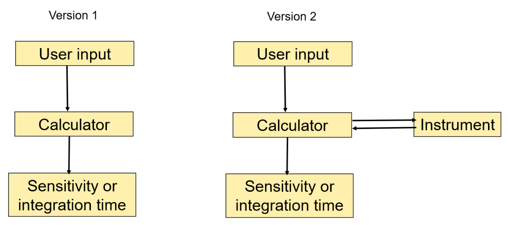

What's new in version 2
=======================

The AtLAST Sensitivity Calculator was first developed as part of the AtLAST Design Study (funded by the European Union's Horizon Europe research and innovation programme under grant agreement No. 951815). As part of the AtLAST2 Design Consolidation Phase (funded by the European Union's Horizon Europe research and innovation programme under grant agreement No. 101188037), a new version of the code has been developed. The key objective of this new version is to provide a calculator that takes into account the variety of instruments that are being developed for current (sub-)mm telescopes so that science users can better constrain their science cases and instrument builders can better understand how their instruments will interact with the telescope and how best to improve their instruments to better satisfy the needs of the science community.

Representation of real instruments
++++++++++++++++++++++++++++++++++
Version 1 of the calculator assumed a generic coherent receiver with a receiver temperature linearly dependent on frequency in :doc:`the radiometer equation <../calculator_info/sensitivity>`. In this new version, we have worked with builders of (sub-)mm instruments to understand how to represent their instruments that have been or are being built for other telescopes in the code so that they can be used as examples of the different types of instrument that will be built for AtLAST. These instruments include high resolution heterodyne spectrometers, continuum cameras using Kinetic Inductance Detector (KID) technology and an Integrated Field Unit using KID technology. Initially, this included the following five instruments:

* CHAI
* FINER
* MUSCAT
* SEPIA
* TIFUUN

For the heterodyne instruments, we can represent their sensitivity the same way we did for the generic coherent receiver, but this time using the measured receiver temperature, which was provided by the instrument builders as either a constant per band or a parameterised equation for the dependence on frequency. KIDs, on the other hand, are impacted by noise in a slightly different way. This is generally described by a noise equivalent power (NEP), which cannot simply be converted to an equivalent receiver temperature as this equivalence will still depend on the environmental noise. We found that we could convert this to a system temperature through the equation:

.. math::
    T_\mathrm{sys} = \frac{\mathrm{NEP}}{k\,\eta_\mathrm{chip}\,\eta_\mathrm{co}\,\eta_\mathrm{eff}\,t_\mathrm{r}\,\sqrt{2n_\mathrm{pol}\,\Delta\nu} } \label{etsysmkid}

where

* :math:`\eta_\mathrm{eff}` is the forward efficiency
* :math:`\eta_\mathrm{chip}` is the pixel efficiency
* :math:`\eta_\mathrm{co}` is the cold optics optical efficiency due to the Lyot stop illumination
* :math:`\mathfrak{t}` is the atmospheric transmittance, defined as :math:`\mathfrak{t} = \textrm{exp}^{(-\tau_{atm})}`
* :math:`n_\mathrm{pol}` is the number of polarisations being averaged over
* :math:`\Delta\nu` is the bandwidth

We, therefore re-arranged the calculator so that the user input, telescope and environment parameters are passed to the instrument module for the chosen instrument, which calculates the system temperature and then returns this to the core calculator for the SEFD and final sensitivity equation. For more details on the instruments and their system temperature calculations see :doc:`the instrument overview <../calculator_info/instrument_overview>`. For information on how to make use of these in the command line interface see :ref:`the instrument selection <section_instrument_selection>` section. Jupyter notebooks are also provided to demonstrate their usage and to show users the underlying calculations for each instrument.

For the command line interface, the calculator has been designed to dynamically select an instrument based on the user input, specifically the observing frequency and bandwidth. For each instrument, we provide a range of parameters over which that instrument is selectable. Then we provide an instrument order preference that sets which instrument gets chosen when more than one is selectable for the current user input parameters. This process means that the user is always provided with an instrument relevant to their observations without needing to look up the appropriate instrument. However, if the user wishes to choose a different instrument to the one that is dynamically selected, they also have that option. For a specific calculation, they can use :meth:`chosen_instrument <atlast_sc.calculator.Calculator.chosen_instrument>` to select a specific instrument of their choice (although errors will be given if the instrument is not available for the current observing frequency or bandwidth). They can also change the :meth:`instrument_order_preference <atlast_sc.calculator.Calculator.instrument_order_preference>` if they wish to ensure a given instrument is always chosen for the parameter space where it is valid.

The code has now been designed to make it possible to add further instruments, which can be achieved by following the instructions on :doc:`adding a new instrument <../developer_guide/adding_new_instrument>`. This involves creating a module that calculates the system temperature, a text file that contains the relevant constants, adding the new instrument to the configuration module, creating a documentation page and creating a Jupyter notebook to demonstrate the instrument. This workflow has been tested by the teams behind the :doc:`MISTRAL continuum camera <../calculator_info/instruments/mistral_tsys>` and the :doc:`SRT Q Band heterodyne receiver <../calculator_info/instruments/SRTQband_tsys>`. We have also added the :doc:`ALMA and ALMA WSU receivers <../calculator_info/instruments/alma_tsys>` using this process.

The generic receiver used in version 1 can still be accessed by selecting the instrument labelled 'Default'. However, note that this will not provide exactly the same results as before as improvements have been made to the treatment of temperatures in the code, as detailed :ref:`below <section_temperature_changes>`.

Code refactor
+++++++++++++

Each instrument requiring its own system temperature calculation necessitated
a restructuring of the code. Previous version of the calculator had a single module 
that contained all of the code for the calculator. This has now been split into core 
calculator modules, instrument modules, parameter modules for handling different types 
of parameters and other parameters that are derived from them. With this, the core calculator
code is much simpler and easier to understand. This separation also allows the extension of
the functionality of the calculator to include new instruments and their unique parameters or 
functions without having to modify the core calculator code. Decoupling and breaking the 
process of the calculator into different modules also allows for easier modification of
the process in the future.

The separation of the code into different modules has allowed us to improve the 
handling of the parameters. In version 1, all of the parameters were stored in a single 
class, which made it difficult to understand which parameters were user inputs, which were 
telescope and environment parameters and which were derived parameters. In this new version, 
we have separated these into various classes, which makes it easier to understand what 
each parameter is and how it is used in the calculations. This separation also allows a 
stringification method to be specified for each of these classes, where the user can easily 
see the current values of all of the parameters in that class. 

As each instrument needed its own system temperature calculation, we also needed 
to store the parameters that are used in these calculations somewhere that makes logical
sense with respect to the core calculator. This has been achieved by creating a separate 
class for each instrument, which contains the parameters that are relevant to that instrument. 
This setup makes it trivial to add new instruments to the process in the future without 
having to modify the core calculator or its process.

Additionally, the calculated integration time or sensitivity was previously stored in the
same parameter as their relative user input. For example, if the user wanted to calculate
integration time, the resulting value would be stored in the same parameter as 
when the user enters an integration time if they wanted to calculate sensitivity. In the 
new version, the calculated integration time and sensitivity are stored in separate 
parameters from the user input equivalents to avoid confusion, overwriting of values and
better handling. This also allows different specification for the units of the user input 
and calculated values, for example, the user can provide a sensitivity in mJy for one 
equation and the calculated sensitivity value for another can be output in K.

.. note::

    Users should note that some of these changes has resulted in some backwards incompatibility. Anyone who has code that used the previous version of the calculator will need to update some of their commands. The changes needed are detailed here.

    The parameters are now stored in the classes ``user_input``, ``telescope_and_environment`` and ``derived_parameters``. For instance, in version 1, a user input parameter could be changed by calling:

    .. code-block:: python

        calculator.bandwidth = 50*u.GHz

    whereas in version 2 this now needs to be:

    .. code-block:: python

        calculator.user_input.bandwidth = 50*u.GHz   

    Similarly, the class needs to be included when checking the current value of each parameter, e.g.:

    .. code-block:: python

        print(calculator.telescope_and_environment.eta_eff)
        print(calculator.derived_parameters.T_sky)

    The full list of parameters in each class is shown in :doc:`Inputs to the Calculation <../calculator_info/calculation_inputs>`.

    The way in which the current parameters can be displayed has also changed. Previously it was necessary to use ``print()``:

    .. code-block:: python

        print(calculator.user_input)
        print(calculator.instrument_setup)
        print(calculator.derived_parameters)

    Now there is a .show() method for each of these classes:
    
    .. code-block:: python

        calculator.user_input.show()
        calculator.telescope_and_environment.show()
        calculator.derived_parameters.show()

Unit conversions
++++++++++++++++
In version 1 of the calculator, each of our user inputs only accepted one type of unit (frequency for observing frequency and bandwidth, flux density for sensitivity, time for integration time and degrees for elevation, with number of polarisations and weather being unitless). For spectral line observations, it is often useful to be able to define the bandwidth (i.e. spectral channel width) in terms of a velocity and the sensitivity in terms of a brightness temperature. Users now have this possibility and so can define the bandwidth in terms of m/s or km/s and the sensitivity in terms of mK and K, for example:

.. code-block:: python

    calculator.user_input.bandwidth = 100*(u.m/u.s)
    calculator.user_input.sensitivity = 3*u.mK

If the user is providing an integration time and wants to output the sensitivity in terms of a brightness temperature, this can be done using:

.. code-block:: python

    calculator.calculate_sensitivity(brightness_temperature=True)

Note that the bandwidth and sensitivity are still stored as frequency and flux density respectively. However, we do also provide helpful utilities to allow the user to do their own conversions:

.. code-block:: python

    print(calculator.convert_flux_density_to_brightness_temperature(50 * u.mJy))
    print(calculator.convert_brightness_temperature_to_flux_density(300 * u.mK))
    print(calculator.convert_frequency_to_velocity(65 * u.Hz))
    print(calculator.convert_velocity_to_frequency(40 * u.m / u.s))

For more details see the section on :ref:`unit conversions <section_unit_conversions>`.

Web client updates
++++++++++++++++++
The web client can be run locally and is also available on the `AtLAST website <https://senscalc.atlast.uio.no/>`__. The above implementations for the new instruments and the unit conversions have been propagated into the web client. This now includes an instrument selection box. As well as allowing the user to select the instrument they desire, this provides information on the instruments available for the current observing frequency and bandwidth and the ranges for the currently selected instrument. Clear error messages are provided if the user selects an instrument that does not fit with the currently selected frequency and bandwidth. Extra information has also been added to describe each of the input parameters.

.. _section_temperature_changes:

Changes to the treatment of temperatures
++++++++++++++++++++++++++++++++++++++++
During the process of working with the instrument builders to understand their instruments, we discovered that there were a few inconsistencies with the equations for the system temperature, which required the following changes:

* The contribution from the cosmic microwave background (CMB) was being counted twice as it was included in the output from the *am* code and also again in our equation for the sky temperature. We changed this so that it is only included in the sky temperature equation and not in the *am* code output.
* The CMB temperature was not being multiplied by the transmittance. This factor has now been added.
* All of the temperatures that contribute to the noise should be Rayleigh-Jeans brightness temperatures, as described in, e.g., section 13.2.1 of Interferometry and Synthesis in Radio Astronomy. This was not the case and so we have changed the *am* code output to ensure that our atmospheric temperature is a Rayleigh-Jeans brightness temperature and adapted our CMB temperature and ambient temperature using equation 10 from ALMA memo 602. Note that the receiver temperature remains unchanged as this is defined as a Rayleigh-Jeans brightness temperature.

The following plot shows the ratio between the final system temperature after taking into account these changes compared to the original system temperature from version 1 of the code. From this we can see that, for most frequencies, the new results are within 10% of the previous values. This means that estimates made with the previous version are still good estimates given that many other aspects of the telescope will not be known to this level of accuracy until the telescope is built. 

.. image:: imgs/ratio_tsys.png
    :alt: Ratio of new system temperature to old system temperature
    :align: center
    :width: 500px

Dependency updates
++++++++++++++++++
The first version of the code was written in 2023 for Python 3.10. This version of Python is no longer supported. To ensure compatibility with currently supported versions of Python, we have updated a number of our dependencies:

* python 3.10 => 3.13
* astropy 5.1 => 7.0
* numpy 1.23 => 2.1
* scipy 1.9 => 1.14
* pydantic 1.10 => 2.12

