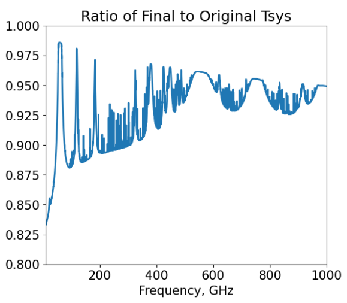

What's new in version 2
=======================

The AtLAST Sensitivity Calculator was first developed as part of the AtLAST Design Study (funded by the European Union's Horizon Europe research and innovation programme under grant agreement No. 951815). As part of the AtLAST2 Design Consolidation Phase (funded by the European Union's Horizon Europe research and innovation programme under grant agreement No. 101188037), a new version of the code has been developed. The key objective of this new version is to provide a calculator that takes into account the variety of instruments that are being developed for current (sub-)mm telescopes so that science users can better constrain their science cases and instrument builders can better understand how their instruments will work with the telescope and how best to improve their instruments to better satisfy the needs of the science community.

New instruments
+++++++++++++++
Version 1 of the calculator assumed a generic coherent receiver with a receiver temperature linearly dependent on frequency in :doc:`the radiometer equation <../calculator_info/sensitivity.rst>`. In this new version, we have worked with builders of (sub-)mm instruments to understand how to represent their instruments that have been or are being built for other telescopes in the code so that they can be used as examples of the different types of instrument that will be built for AtLAST. These instruments include high resolution heterodyne spectrometers, continuum cameras using Kinetic Inductance Detector (KID) technology and an Integrated Field Unit using KID technology. Initially, this included the following five instruments:

* CHAI
* FINER
* MUSCAT
* SEPIA
* TIFUUN

For the heterodyne instruments, we can represent their sensitivity the same way we did for the generic coherent receiver, but this time using the measured receiver temperature, which was provided by the instrument builders as either a constant per band or a parameterised equation for the dependence on frequency. KIDs, on the other hand, are impacted by noise in a slightly different way. This is generally described by a noise equivalent power (NEP), which cannot simply be converted to an equivalent receiver temperature as this equivalence will still depend on the environmental noise. We found that we could convert this to a system temperature through the equation:

.. math::
    T_\mathrm{sys} &=& \frac{\mathrm{NEP}}{k\,\eta_\mathrm{chip}\,\eta_\mathrm{co}\,\eta_\mathrm{eff}\,t_\mathrm{r}\,\sqrt{2n_\mathrm{pol}\,\Delta\nu} } \label{etsysmkid}

where

* :math:`\eta_\mathrm{eff}` is the forward efficiency
* :math:`\eta_\mathrm{chip}` is the pixel efficiency
* :math:`\eta_\mathrm{co}` is the cold optics optical efficiency due to the Lyot stop illumination
* :math:`\mathfrak{t}` is the atmospheric transmittance, defined as :math:`\mathfrak{t} = \textrm{exp}^{(-\tau_{atm})}`
* :math:`n_\mathrm{pol}` is the number of polarisations being averaged over
* :math:`\Delta\nu` is the bandwidth
We, therefore re-arranged the calculator so that the system temperature is being calculated for the selected instrument in the relevant instrument module and then returned to the core calculator for the SEFD equation. For more details on the instruments and their system temperature calculations see :doc:`the instrument overview <../calculator_info/instrument_overview>`. For information on how to make use of these in the command line interface see :ref:`the instrument selection <section_instrument_selection>` section. 

The code has now been designed to make it possible to add further instruments, which can be achieved by following the instructions on :doc:`adding a new instrument <../developer_guide/adding_new_instrument>`. 

The generic receiver used in version 1 can still be accessed by selecting the instrument labelled 'Default'. However, note that this will not provide exactly the same results as before as improvements have been made to the treatment of temperatures in the code, as detailed in the next section.

Code refactor
+++++++++++++
The codebase has been refactored to have a more modular structure for the calculation process. In the
previous version, the code was structured in a singular streamlined process that made it difficult
to modify the calculation process. The new structure allows for better organisation of the
code and makes it easier to add new instruments or to modify the calculation process in the
future. These changes include separating the calculation input parameters into different classes 
based on their category, and introducing instrument modules where instrument data and methods are 
stored (see :ref:`Class Structure <class structure>` for a high level view of the new structure).

.. note::

    Users should note that this change has resulted in some backwards incompatible changes and so anyone who has code that used the previous version will likely need to update some of their commands. The changes needed are detailed here.

    The parameters are now stored in the classes ``user_input``, ``telescope_and_environment`` and ``derived_parameters``. For instance, in version 1, a user input parameter could be changed by calling:

    .. code-block:: python

        calculator.bandwidth = 50*u.GHz

    whereas in version 2 this now needs to be:

    .. code-block:: python

        calculator.user_input.bandwidth = 50*u.GHz   

    Similarly, the class needs to be included when checking the current value of each parameter, e.g.:

    .. code-block:: python

        print(calculator.telescope_and_environment.eta_eff)
        print(calculator.derived_parameters.T_sky)

    The full list of parameters in each class is shown in :doc:`Inputs to the Calculation <../calculator_info/calculation_inputs>`.

    The way in which the current parameters can be displayed has also changed. Previously it was necessary to use ``print()``:

    .. code-block:: python

        print(calculator.user_input)
        print(calculator.instrument_setup)
        print(calculator.derived_parameters)

    Now there is a .show() method for each of these classes:
    
    .. code-block:: python

        calculator.user_input.show()
        calculator.telescope_and_environment.show()
        calculator.derived_parameters.show()

Unit conversions
++++++++++++++++
In version 1 of the calculator, each of our user inputs only accepted one type of unit (frequency for observing frequency and bandwidth, flux density for sensitivity, time for integration time and degrees for elevation, with number of polarisations and weather being unitless). For spectral line observations, it is often useful to be able to define the bandwidth (i.e. spectral channel width) in terms of a velocity and the sensitivity in terms of a brightness temperature. Users now have this possibility and so can define the bandwidth in terms of m/s or km/s and the sensitivity in terms of mK and K, for example:

.. code-block:: python

    calculator.user_input.bandwidth = 100*(u.m/u.s)
    calculator.user_input.sensitivity = 3*u.mK

If the user is providing an integration time and wants to output the sensitivity in terms of a brightness temperature, this can be done using:

.. code-block:: python

    calculator.calculate_sensitivity(brightness_temperature=True)

Note that the bandwidth and sensitivity are still stored as frequency and flux density respectively. However, we do also provide helpful utilities to allow the user to do their own conversions:

.. code-block:: python

    print(calculator.convert_flux_density_to_brightness_temperature(50 * u.mJy))
    print(calculator.convert_brightness_temperature_to_flux_density(300 * u.mK))
    print(calculator.convert_frequency_to_velocity(65 * u.Hz))
    print(calculator.convert_velocity_to_frequency(40 * u.m / u.s))

For more details see 

Web client updates
++++++++++++++++++
The web client can be run locally and is also available on the `AtLAST website <https://senscalc.atlast.uio.no/>`__. The above implementations for the new instruments and the unit conversions have been propagated into the web client. This now includes an instrument selection box. As well as allowing the user to select the instrument they desire, this provides information on the instruments available for the current observing frequency and bandwidth and the ranges for the currently selected instrument. Clear error messages are provided if the user selects an instrument that does not fit with the currently selected frequency and bandwidth. Extra information has also been added to describe each of the input parameters.

Changes to the treatment of temperatures
++++++++++++++++++++++++++++++++++++++++
During the process of working with the instrument builders to understand their instruments, we discovered that there were a few inconsistencies with the equations for the system temperature, which required the following changes:

* The contribution from the cosmic microwave background (CMB) was being counted twice as it was included in the output from the *am* code and also again in our equation for the sky temperature. We changed this so that it is only included in the sky temperature equation and not in the *am* code output.
* The CMB temperature was not being multiplied by the transmittance. This factor has now been added.
* All of the temperatures that contribute to the noise should be Rayleigh-Jeans brightness temperatures, as described in, e.g., section 13.2.1 of Interferometry and Synthesis in Radio Astronomy. This was not the case and so we have changed the *am* code output to ensure that our atmospheric temperature is a Rayleigh-Jeans brightness temperature and adapted our CMB temperature and ambient temperature using equation 10 from ALMA memo 602. Note that the receiver temperature remains unchanged as this is defined as a Rayleigh-Jeans brightness temperature.

The following plot shows the ratio between the final system temperature after taking into account these changes compared to the original system temperature from version 1 of the code.

Dependency updates
++++++++++++++++++
The first version of the code was written in 2023 for Python 3.10. To ensure compatibility with currently supported versions of Python, we have updated a number of our dependencies:

* python 3.10 => 3.13
* astropy 5.1 => 7.0
* numpy 1.23 => 2.1
* scipy 1.9 => 1.14
* pydantic 1.10 => 2.12

